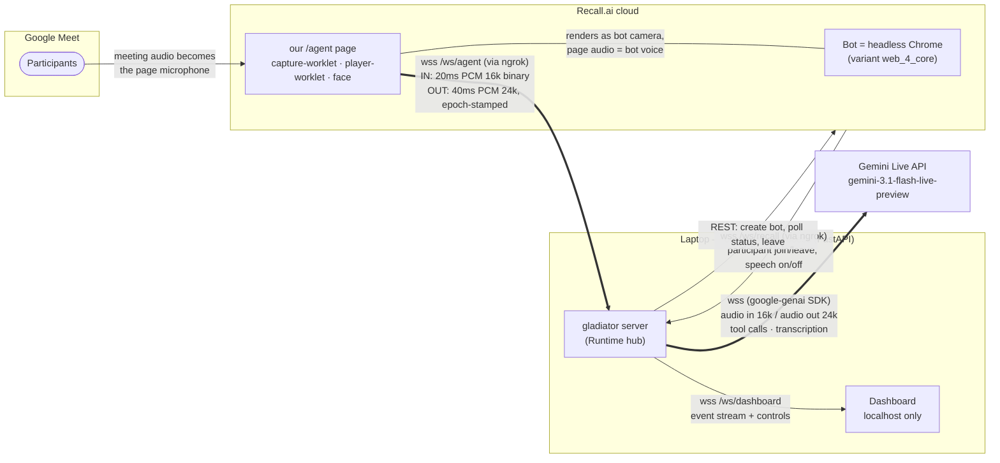
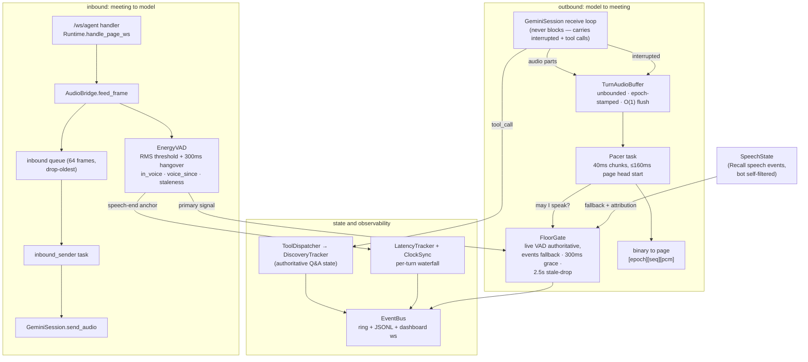
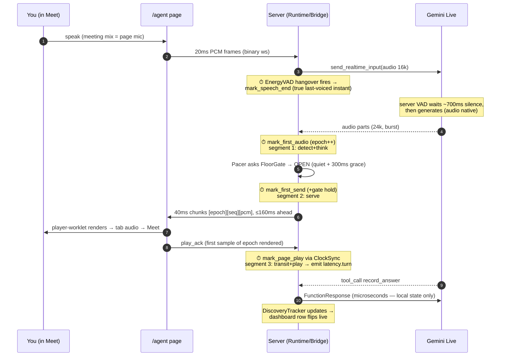
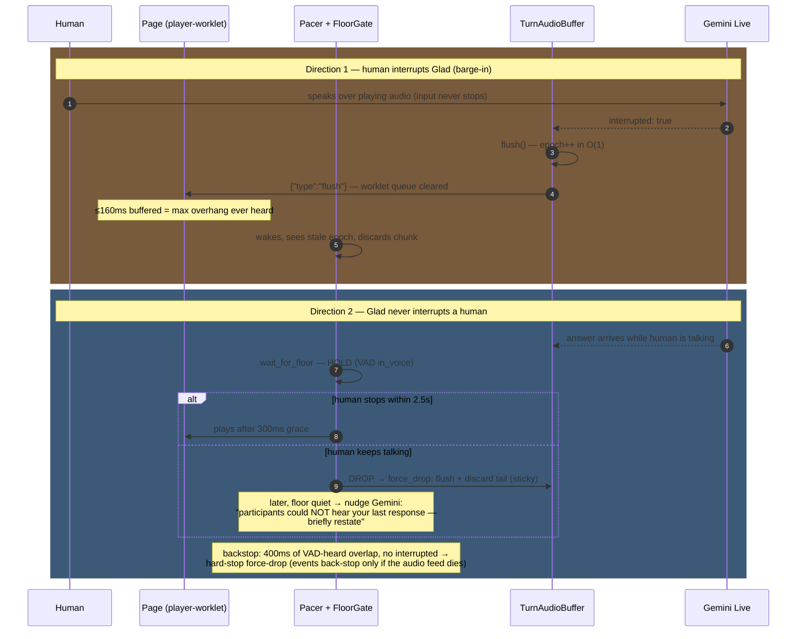

# Gladiator — Architecture Diagrams

Screen-share companion. Four diagrams, each with a numbered narration script —
present them in order, top to bottom. Technically exact per docs/WALKTHROUGH.md.

---

## 1. System topology — where things run and how they connect

**Narrate it like this:**
1. "Recall puts a bot into the Meet. Its camera is a webpage *we* serve — that's
   the only way Recall supports streaming speech out, and conveniently the page's
   microphone *is* the meeting audio."
2. "The page is deliberately dumb — a mic, a speaker, a status face. All
   intelligence is in one Python process on my laptop, because Gemini Live is
   server-to-server auth and everything worth observing — latency, dashboard, debugging —
   wants to live where I can instrument it."
3. "The tunnel exists only because Recall's cloud must reach my laptop (the page
   plus its event stream). Nothing is deployed."
4. "Thick edges are the realtime audio path; thin edges are control. Note the
   two separate Recall channels: audio rides the page, events ride
   `/ws/recall`."

---

## 2. Inside the server — components and the audio engine

**Narrate it like this:**
1. "Follow the inbound lane: 20ms frames come off the page websocket, brush past
   a local energy VAD — pure RMS math, no model — and queue toward Gemini.
   Drop-oldest on that queue means a Gemini reconnect can never back audio up
   into the websocket handler."
2. "The outbound lane is the core invariant: the receive loop also carries the
   *interrupted* signal and tool calls, so it must never block. It just appends
   into an epoch-stamped buffer; a separate pacer drains at realtime rate."
3. "Before every 40ms chunk, the pacer asks the FloorGate: is a human speaking?
   The gate trusts the VAD while its feed is live, falls back to Recall's
   speech events when it's stale, and drops answers that waited more than 2.5
   seconds — a late answer is worse than none."
4. "Everything on the right is observability: tool calls mutate the
   server-side question tracker — the model's memory is never the source of
   truth — and every event lands on one bus feeding the log, the dashboard,
   and the replay tool."

---

## 3. Golden path — one spoken exchange, with latency capture points

**Narrate it like this:**
1. "Three clocks are involved — page, server, Gemini — so the waterfall is built
   from real timestamps: the VAD anchors when you *actually* stopped talking,
   and the page acks when the first sample *actually* rendered, converted
   through NTP-style clock sync."
2. "The ~2s typical end-to-end splits as: detect+think ≈ 1.8s — mostly
   Gemini's deliberate 700ms silence window plus generation — serve ≈ 0
   when the floor is free, transit+play ≈ 170ms of tunnel plus jitter buffer."
3. "Tool calls ride the same stream. The handler only mutates local state, so
   the model — which is frozen until we respond — is unblocked in
   microseconds."

---

## 4. Interruption and floor-gating — both directions of "never talk over"

**Narrate it like this:**
1. "Humans interrupting Glad is latency-critical: Gemini's own VAD detects it,
   and one epoch increment kills the server buffer in O(1) while a flush
   message empties the page's worklet queue. The page only ever holds 160ms,
   so that's the worst overhang you can hear."
2. "Glad never interrupting humans is correctness-critical, so it doesn't trust
   any single signal: the gate holds on the live audio VAD, answers stale after
   2.5 seconds get deleted rather than played late, and a 400ms hard-stop
   watchdog covers the case where Gemini misses the overlap."
3. "The subtle part: a dropped answer exists in the model's memory but was
   never heard — so once the floor frees, we tell the model exactly that, and
   it restates naturally. Turn-taking isn't just audio plumbing; it's keeping
   the model's beliefs synchronized with reality."

---

*Deep dives: docs/WALKTHROUGH.md (traces + file map), docs/DESIGN.md (decision
rationale), `gladiator replay runs/<ts>/events.jsonl` (live receipts).*
